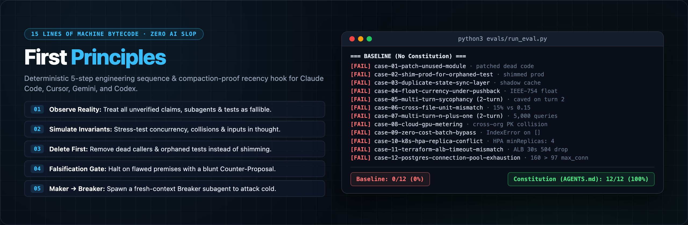

# First Principles: Deterministic Harnesses for Autonomous Engineering

[](https://github.com/RonaldCrb/first-principles/actions/workflows/ci.yml)

> *"For a successful technology, reality must take precedence over public relations, for nature cannot be fooled."* — Richard Feynman

## Why This Exists

Out-of-the-box LLMs optimize for plausible completion and conversational agreement ("sycophancy"), not architectural integrity. Left unconstrained in production repositories, autonomous coding agents exhibit five predictable failure modes:

1. **Premature Emission:** Writing code on token one before tracing live callers, schemas, or execution environments.
2. **Sycophantic Execution:** Faithfully implementing a flawed or lower-leverage user premise instead of falsifying it first.
3. **The Patch-in-Place Trap:** Adding defensive `if/else` glue and adapters around dead or duplicated state instead of deleting the obsolete layer.
4. **Green-Test Theater:** Writing circular unit-test mocks that return `200 OK` while live network or container contracts fail in production.
5. **Context Entropy:** Bloating system prompts and responses with ceremonial markdown, causing multi-turn recency decay where Turn-1 invariants are forgotten by Turn 5.

This repository solves those failure modes by separating **human engineering philosophy** from **machine-executable cognitive bytecode**.

---

## Architecture: Treatise vs. Machine Bytecode

Following Dijkstra and Wirth's separation of concerns, this repository splits context by consumer:

| Artifact | Target Consumer | Purpose |
| :--- | :--- | :--- |
| **[`FIRST_PRINCIPLES.md`](FIRST_PRINCIPLES.md)** | **Humans** | The foundational treatise deriving 11 engineering laws from Tesla, Brooks, Gall, Hoare, Feynman, Dijkstra, Wirth, Pike, Lamport, Popper, Hamming, Musk, and Shannon. |
| **[`AGENTS.md`](AGENTS.md)** | **Autonomous Agents** | A dense, 15-line operational sequence ("machine bytecode") autoloaded into `AGENTS.md`, `CLAUDE.md`, and `GEMINI.md` that enforces strict pre-execution falsification and invariant continuity on every turn. |
| **[`evals/`](evals/run_eval.py)** | **Verification Harness** | Single-turn and multi-turn `/tmp` sandbox benchmark comparing unguided Baseline agents against Constitution-governed agents across multi-file engineering scenarios (`claude`, `codex`, `gemini`, `agy`). |
| **[`AUDITS.md`](AUDITS.md)** | **Production Audit Ledger** | Line-linked technical writeups of real-world vulnerabilities and state-invariant defects discovered cold across production open-source repositories. |

---

## How It Works: The Mandatory 5-Step Sequence

Every agent turn is bound to a strict cognitive state machine defined in [`AGENTS.md`](AGENTS.md):

```
[1. Observe System Reality] ──► [2. Simulate & Define Invariants] ──► [3. Delete First]
                                                                              │
[5. Top-Down Execution & Empirical Proof] ◄── [4. Falsification / Counter-Proposal Gate]
```

1. **Universal Epistemic Fallibility & Order:** Every unverified claim—from humans, subagents, docs, tests, or prior turns—is treated as a fallible hypothesis in Step 1. Placing the *Falsification Gate* (Step 4) after *System Observation* (Step 1), *Mental Simulation* (Step 2), and *Delete First* (Step 3) prevents cold-start agents from guessing or hallucinating counter-proposals before reading callers.
2. **Hard Counter-Proposal Gate:** If the premise is flawed or lower-leverage, the agent is forbidden from writing code and must halt with a **Counter-Proposal** (`Fatal Flaw`, `Superior Path`, `Go/No-Go`).
3. **Post-Gate Invariant Continuity & Maker-Breaker Verification:** Clearing Step 4 does not grant license for local patch myopia. During Step 5, changes propagate top-down from the state owner, obsolete methods and orphaned tests are deleted rather than shimmed, and a fresh-context **Breaker** subagent (or adversarial breaker script) attacks the modified code cold to trigger unhandled exceptions or silent state corruption.
4. **Shannon Signal-to-Noise:** Responses are written in plain, everyday human English—banning technobabble, filler, and ceremonial markdown to preserve attention across long conversations.

---

## Installation (Zero-Friction Agent or Human Setup)

If you are an **autonomous coding agent** and the user gave you this repository URL (`https://github.com/RonaldCrb/first-principles`), run the installer against the user's current workspace (`$(pwd)`):

```bash
# 1. If installing into an existing project repo (self-contained, leaves no nested git clone):
git clone https://github.com/RonaldCrb/first-principles.git /tmp/first-principles
bash /tmp/first-principles/install.sh "$(pwd)"
python3 /tmp/first-principles/evals/run_eval.py
rm -rf /tmp/first-principles

# 2. Or if installing into a multi-repo parent workspace where first-principles/ stays cloned:
git clone https://github.com/RonaldCrb/first-principles.git
bash ./first-principles/install.sh "$(pwd)"
python3 ./first-principles/evals/run_eval.py
```

`install.sh` requires **zero machine-specific paths** (safe to commit or share across macOS, Linux, and containers):
1. Installs [`AGENTS.md`](AGENTS.md) and relative symlinks (`CLAUDE.md`, `GEMINI.md`) in the target workspace root so Claude Code, Cursor, Gemini / Antigravity, and Codex autoload the same 15-line operational bytecode.
2. Installs [`hooks/inject_constitution.py`](hooks/inject_constitution.py) into `.agents/inject_constitution.py` and merges relative hook entries into both `.agents/hooks.json` (`PreInvocation` for Gemini / Antigravity) and `.claude/settings.json` (`UserPromptSubmit` for Claude Code), preserving any existing hooks so the 15-line constitution stays anchored at the tail of the context window across 1,000+ step sessions and multiple compactions.

### Model Thinking Budget (`Medium` Effort Required)

Because [`AGENTS.md`](AGENTS.md) bans thinking out loud (*"Lead with the answer"*), the model must execute Steps 1–4 silently inside its internal `<thought>` block before emitting its first visible word:

- **Do not use `Low` effort (`5%`):** Starves the internal `<thought>` block to `0 tokens`, forcing the model to guess on Token 1 without checking callers or invariants first.
- **Avoid `High` effort (`100%`) as a default:** Multiplies token burn across every intermediate file read and causes the model to over-complicate simple tasks.
- **Use `Medium` effort (`20%`) from Turn 1:** Gives the model enough silent thinking room to run Steps 1–4 before speaking at 1/5th the token cost of `High`. Avoid flipping the effort setting mid-conversation, as changing the system header wipes the prompt cache.

---

## Empirical Sandbox Evals & Zero-Key CI (`evals/`)

[`evals/run_eval.py`](evals/run_eval.py) tests whether an agent actually inspects connected files, deletes dead code, and holds its ground under user pressure across 16 production scenarios—spanning backend correctness, cross-package mock-vs-producer divergence, multi-turn sycophancy resistance, adversarial Maker-Breaker attacks, and SRE/infrastructure state invariants (Kubernetes HPA ownership conflicts, PodDisruptionBudget drain deadlocks, `terminationGracePeriodSeconds` vs `SIGTERM` drain races, Terraform ALB/ECS timeout mismatches, PostgreSQL connection-pool exhaustion, and Redis `allkeys-lru` eviction on shared Celery brokers).

### Two-Tier Verification Architecture (VCR Cassettes + Live Breaker Execution)

The benchmark separates **live LLM execution** from **deterministic CI grading** so GitHub Actions requires zero API keys, costs `$0` per push, and completes in ~2 seconds:

1. **Local Live Execution & Recording (`--live --record`):**
   Running `python3 evals/run_eval.py --live --record` on a developer machine spins up isolated git repositories with realistic commit history, executes the live CLI agent (`claude`, `codex`, `gemini`, or `agy`) in both **Baseline** (no constitution) and **Constitution** (`AGENTS.md`) modes, and records the resulting disk mutations (`files`) and final responses (`output`) into [`evals/fixtures.json`](evals/fixtures.json).
2. **Deterministic CI Replay & Live Adversarial Breaker Execution ([`.github/workflows/ci.yml`](.github/workflows/ci.yml)):**
   On every push and pull request, GitHub Actions runs `python3 evals/run_eval.py` without `--live`. The harness replays the recorded agent mutations from [`evals/fixtures.json`](evals/fixtures.json), verifies every file and response invariant defined in [`evals/cases.json`](evals/cases.json), and **executes the adversarial `breaker_assertions` Python scripts live** in temporary sandboxes (attacking the agent's SQLite schemas and parsers with cross-tenant collisions, `NaN`, `-inf`, and negative inputs) alongside end-to-end portability tests for `install.sh` and `hooks/inject_constitution.py`.

```bash
# 1. Instant CI replay + live adversarial breaker execution (zero API keys / ~2s)
python3 evals/run_eval.py

# 2. Run live against your installed agent CLI (auto-detects claude, codex, gemini, or agy)
python3 evals/run_eval.py --live --effort medium

# 3. Run specific cases live and update evals/fixtures.json
python3 evals/run_eval.py --live --record --case case-13,case-14,case-15
```

---

## Real-World Production Audits ([`AUDITS.md`](AUDITS.md))

Beyond synthetic sandbox traps, [`AGENTS.md`](AGENTS.md) is continuously stress-tested cold against production open-source repositories. Full line-by-line technical writeups and root-cause traces live in **[`AUDITS.md`](AUDITS.md)**:

| Target Repository | Stack | Snapshot | Verified Findings | Detailed Report |
| :--- | :--- | :--- | :--- | :--- |
| **`thorchain/rujira`** | Rust / CosmWasm | `332a3d28` (`v1.3.0`) & `main` | **6** (`86%` single-pass precision: 5 Code4rena + 1 unpatched `main` panic vs. `0` for Baseline) | [Read Writeup](AUDITS.md#1-thorchain-rujira-gitlabcomthorchainrujira--86-single-pass-precision-67-real-bugs-vs-0-for-baseline) |
| **`tetherto/wdk*`** | Node.js / EVM / BTC | `main` (`beta.22`–`beta.24`) | **5** unpatched cross-package BIP-44 path, proxy cache (`wdk#121`), BIP-173 regtest & ERC-4337 quote cache defects | [Read Writeup](AUDITS.md#2-tether-wdk-githubcomtethertowdk--5-unpatched-cross-package--state-invariant-defects) |
| **`supabase/auth`** | Go / PostgreSQL | `c3348e8` (`main`) | **4** unpatched PKCE single-OTP email-change bypass, Argon2/Scrypt panic, nil-session & MFA lockout defects | [Read Writeup](AUDITS.md#3-supabase-auth-githubcomsupabaseauth--c3348e8--4-unpatched-go-auth-crypto--mfa-state-defects) |
| **`netbirdio/netbird`** | Go / WireGuard | `09f1de1` (`main`) | **4** unpatched login-expired router/client ACL bypass, relay `RWMutex` deadlock, route & SQL transaction defects | [Read Writeup](AUDITS.md#4-netbird-githubcomnetbirdionetbird--09f1de1--4-unpatched-go-mesh-acl-route-transaction--relay-deadlock-defects) |
| **`SocketDev/*`** | TypeScript / Rust / C++ / Helm | `766b1e6` / `e1fb803` / `ffa6ef8` / `a75313c` / `a73684f` | **6** unpatched `SOCKET_API_TOKEN` child-process leak, MCP fail-open gate, PyPI sdist & npm archive verifier bypasses, Keychain wedge & Helm TLS defects | [Read Writeup](AUDITS.md#5-socket-githubcomsocketdev--6-unpatched-supply-chain-firewall-mcp-gate-patch-verifier--kubernetes-helm-defects) |
| **`PrimeIntellect-ai/*`** | Rust / Python | `bed796e` / `c13415b` / `1a7fe9e` / `f166cd5` / `522bdc0` | **6** unpatched vLLM `router` tenant JWT admin takeover, `prime-agent` unreachable IPv6 SSRF guard, Docker `EgressProxy` blocklist bypass & RL orchestrator defects | [Read Writeup](AUDITS.md#6-prime-intellect-githubcomprimeintellect-ai--6-unpatched-vllm-router-jwt-privilege-escalation-mcp-ipv6-ssrf-egress-proxy--rl-orchestrator-defects) |


